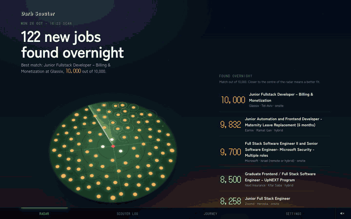
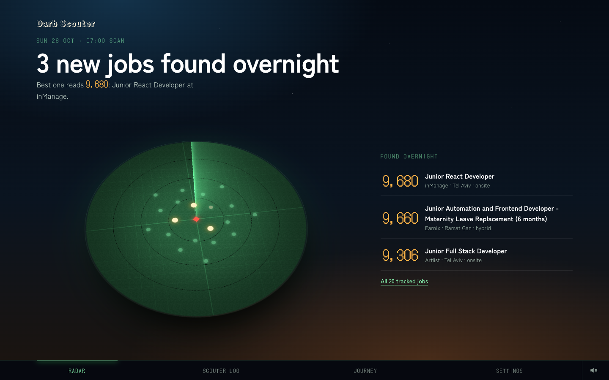
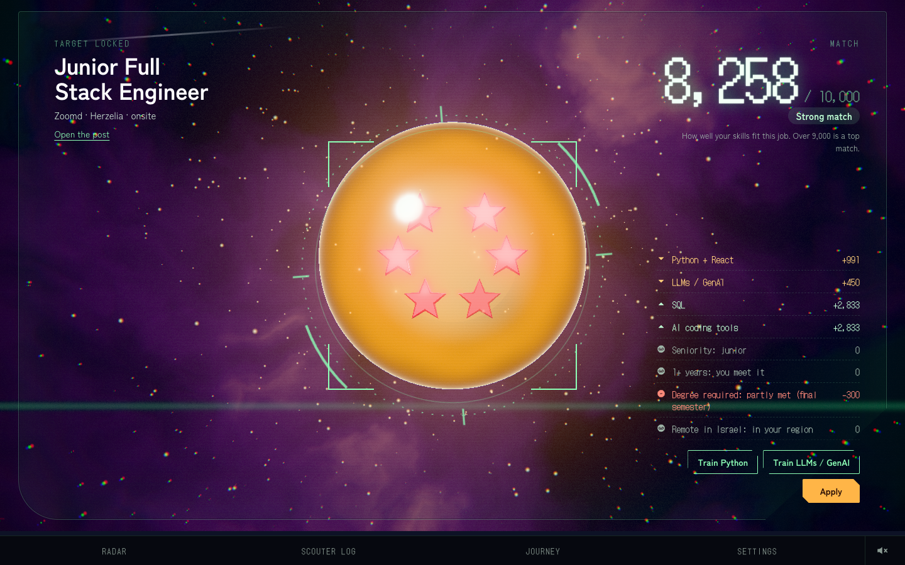
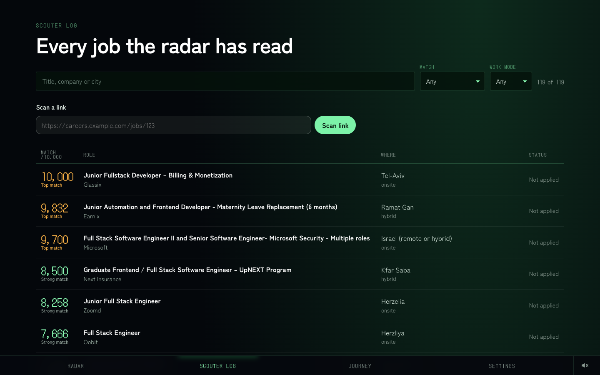
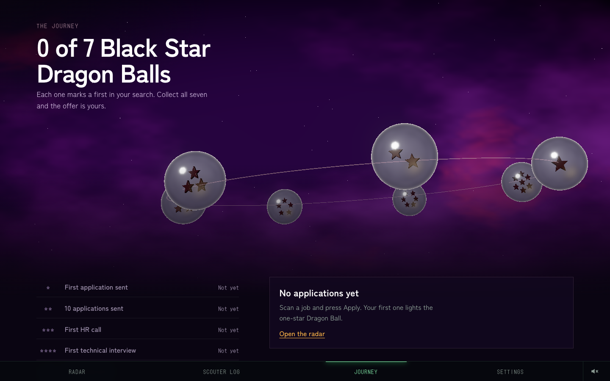
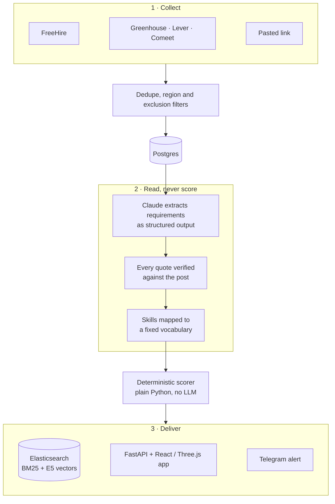

<div align="center">

# Darb Scouter

**Reads every new junior software job in Israel each morning, checks it against my CV, and tells me honestly how well I fit, with a quote from the post behind every point.**

**[Try the live demo](https://darb-scouter.vercel.app)**: it runs on sample data, no keys or sign-up.

[](https://github.com/b14ckPanther/darb-scouter/actions/workflows/backend.yml) [](https://github.com/b14ckPanther/darb-scouter/actions/workflows/frontend.yml)    [](LICENSE)



</div>

## The problem

Job hunting as a new graduate means reading the same few hundred near-identical posts every week and guessing which ones are realistic. Job boards rank by date or keywords, and AI "match scores" are usually a flattering number with no explanation.

I wanted the opposite: a number I can trust because I can check it. Darb Scouter gives each job a **match score out of 10,000** and shows every line that makes it up, each one tied to a sentence quoted from the post. If a requirement can't be quoted, it doesn't score. If a post asks for three years of experience, the score drops, however good the skill match looks.

It runs on my Mac every morning at 07:00. Its first live scan read **1,294 listings** from FreeHire and 43 company career boards.

## What you're looking at

<table>
<tr>
<td width="50%"></td>
<td width="50%"></td>
</tr>
<tr>
<td><b>Radar.</b> The morning screen. Each new job is a blip; better matches sit closer to the centre.</td>
<td><b>Scouter.</b> One job, broken down line by line. "Train Python" shows how much the score would rise if that skill were proven.</td>
</tr>
<tr>
<td></td>
<td></td>
</tr>
<tr>
<td><b>Log.</b> Every job ever read, with search in Hebrew and English. Paste any link to scan it on demand.</td>
<td><b>Journey.</b> Applications tracked as seven milestones, from first application to offer.</td>
</tr>
</table>

## How it works



1. **Collect.** Each source runs on its own, so one broken board never stops the scan. A discovery step adds new company boards a few at a time, to keep the scan short and polite.
2. **Filter before spending.** Duplicates are merged with fuzzy matching on title and text. Jobs abroad, or at employers on a configurable exclusion list, are dropped before any model call.
3. **Extract.** A LangGraph pipeline asks Claude for the requirements as typed, structured output. The model only reads the post. It never decides the score.
4. **Verify.** Every requirement must come with a quote, and the quote is checked against the original text. Requirements that can't be found in the post are thrown away.
5. **Score.** Plain, tested Python turns the verified requirements and my skill profile into a number. The same input always gives the same score.
6. **Deliver.** Jobs are indexed for hybrid search, the best matches go to Telegram, and the app shows the rest.

## Engineering decisions worth a look

| Decision | Why |
|---|---|
| **The LLM reads, code scores** | A model is good at reading messy posts and bad at being consistent. Splitting the two makes the score reproducible, unit-testable and explainable. See [`scoring.py`](backend/src/scouter/scoring.py). |
| **No quote, no points** | Each requirement carries evidence that is matched back to the post before it can count. A made-up requirement becomes a dropped line instead of a silent error. See [`extract/graph.py`](backend/src/scouter/extract/graph.py). |
| **Honest by construction** | Seniority, years of experience and degree requirements can only lower the score. A requirement the scouter doesn't recognise still gets a line, worth 0, so gaps stay visible. |
| **Pay once per post** | Extractions are cached by a hash of the post and the model. Updating my skills rescores every job instantly, with no model calls. The system prompt uses prompt caching. |
| **Failures stay small** | A post that fails stays pending and retries next run; after 3 tries it is parked. After 3 model failures in a row, the run stops calling the model. A broken collector is noted in the run summary, never raised. |
| **Runs on a laptop that sleeps** | The scan runs at 07:00. If the Mac was asleep, it catches up once on wake. A Postgres advisory lock stops two scans from overlapping. See [`scheduler.py`](backend/src/scouter/scheduler.py). |
| **Hybrid search in two languages** | BM25 and multilingual E5 vectors are fused by reciprocal rank, so a Hebrew query finds English posts and the other way round. See [`search.py`](backend/src/scouter/search.py). |
| **Config, not code** | Regions (place names in Hebrew and English), exclusions, thresholds, the skill vocabulary and the boards live in YAML or the database. Tuning never needs a code change. |
| **Costs nothing when idle** | The daily scan is a switch in Settings and starts off. The scheduler checks it before every run, so nothing calls the model until you turn it on or press Scan now. |
| **Private by default** | Every port is bound to localhost. The API requires a token, compared in constant time. Secrets live only in `.env`. |
| **Measured, not assumed** | An eval harness compares the scouter's ranking with my own hand scores (Spearman ρ) and checks extraction precision and recall. See [`evals/`](evals). |

## Stack

| Layer | Tools |
|---|---|
| **Backend** | Python 3.13, FastAPI, Pydantic, SQLAlchemy 2, Alembic, uv |
| **AI** | Claude Sonnet 5.5 through the Anthropic SDK (structured outputs, prompt caching, server-side fallback), LangGraph |
| **Search** | Elasticsearch 8: BM25 plus multilingual E5 embeddings |
| **Data** | PostgreSQL 16 |
| **Scheduling and alerts** | APScheduler, Telegram Bot API |
| **Frontend** | React 19, TypeScript, Vite, React Router, GSAP |
| **3D and sound** | Three.js with custom GLSL shaders and post-processing; sound synthesised live with the Web Audio API |
| **Infra** | Docker Compose, GitHub Actions |

## Run it

**See the interface in 30 seconds.** There are no keys and no backend; it runs on labelled demo data:

```bash
cd frontend && npm install && npm run dev
```

**Run the whole system.** You need Docker and an Anthropic API key:

```bash
cp .env.example .env          # add ANTHROPIC_API_KEY and a SCOUTER_TOKEN (openssl rand -hex 24)
docker compose up -d --build  # Postgres, Elasticsearch, the API with the app, and the scheduler
scripts/smoke.sh              # checks that the API and the app answer
open http://localhost:8000    # paste the token under Settings
```

The daily 07:00 scan is **off** until you switch it on in Settings, so an idle install never spends anything on the model. **Scan now** in Settings runs one scan at any time, or from the terminal:

```bash
curl -X POST -H "X-Scouter-Token: $SCOUTER_TOKEN" localhost:8000/api/runs
```

Telegram alerts, phone access over Tailscale and backups are covered in [`docs/ops.md`](docs/ops.md).

## Make it yours

I built it for my own search in Israel, but nothing about me or Israel lives in the code. It's all YAML in [`backend/src/scouter/`](backend/src/scouter):

| File | What to change |
|---|---|
| `profile.yaml` | Your skills, years of experience and degree. Put personal overrides in `profile.local.yaml` (git-ignored); after the first import you edit it in Settings. |
| `regions.yaml` | The places you'd work, as regex in any language. |
| `boards.yaml` | Company boards on Greenhouse, Lever or Comeet. Those work anywhere; FreeHire is the Israel-specific source. |
| `exclusions.yaml` | Employers you never want to see. |
| `vocab.yaml` | The skill vocabulary and its aliases. |
| `tuning.yaml` | Dedupe thresholds, discovery pace and FreeHire roles. |

If you adapt it to another country or add a new board type, I'd love a PR or an issue telling me how it went.

## Tests

| Suite | What it covers | Tests |
|---|---|---|
| **pytest** | Scoring, the extraction graph, collectors, dedupe, filters, scheduler catch-up, the API and its security, against real Postgres and Elasticsearch | 167 |
| **Vitest and Testing Library** | Domain logic and every screen | 81 |
| **Playwright** | End-to-end flows, phone width, keyboard-only use, reduced motion and axe accessibility checks | 13 |
| **Evals** | The scouter's ranking against hand-scored jobs | in progress |

GitHub Actions runs every suite on every push, plus ruff and strict mypy.

## Project layout

```
backend/src/scouter/
  collectors/      FreeHire, Greenhouse, Lever, Comeet, pasted links
  extract/         LangGraph pipeline, Claude client, extraction prompt
  scoring.py       the deterministic match score
  pipeline.py      collect -> filter -> dedupe -> extract -> score -> index -> alert
  scheduler.py     07:00 scan with catch-up on wake
  search.py        hybrid BM25 + vector search
  api.py           FastAPI, which also serves the built app
  *.yaml           regions, exclusions, tuning, vocabulary, boards
frontend/src/
  screens/         Radar, Scouter, Log, Journey, Settings
  three/           WebGL scenes and shaders
  audio/           synthesised sound
  data/            API client, with demo data for offline mode
evals/             pick, label and measure against hand scores
docs/              design spec and operations guide
```

## Accessibility

Every blip, score line and control is reachable by keyboard and has a visible focus ring. With reduced motion turned on, every animation jumps to its final state. Without WebGL, each 3D scene falls back to a still image and the page still works. Sound stays off until you turn it on.

## Status

The full system runs every day. Two pieces are still open:

- **Evals.** The harness is built, and hand-scoring the first 30 jobs is in progress.
- **Semantic skill matching.** An embedding fallback for unusual skill names is built, but it stays off until the evals calibrate its threshold.

## About

I'm **Nour Alden Mousa**, a final-semester B.Sc. Information Systems Engineering student in Haifa, looking for a junior role in software engineering: full-stack, frontend, DevOps or AI engineering. I built Darb Scouter end to end: the design, the backend, the AI pipeline, the 3D interface and the tests. It belongs to **Darb**, the family of projects I build under one name.

The look is inspired by the scouter from Dragon Ball. Every visual and sound is original and made in code; no official art, logos, characters or audio are used.

[GitHub](https://github.com/b14ckPanther) · [MIT License](LICENSE)
